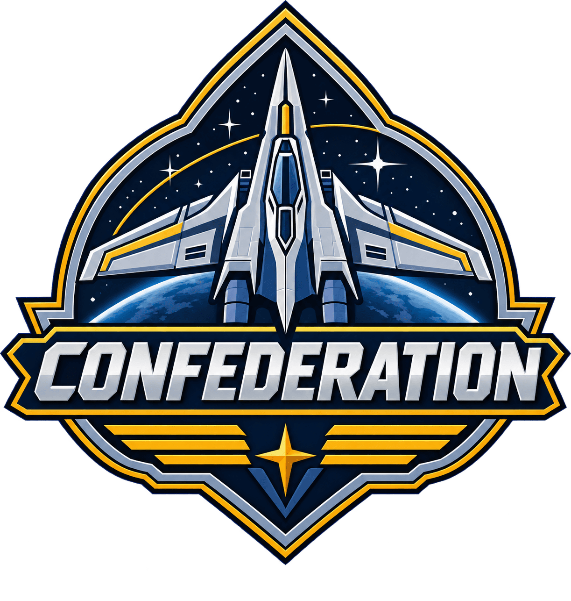
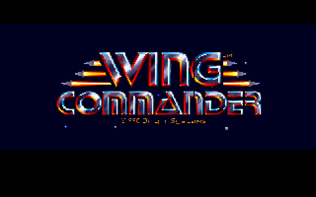
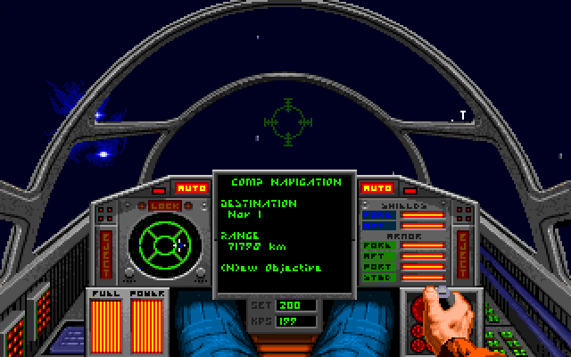

<h1 align="center">
  
</h1>

**Confederation** plays the original DOS *Wing Commander* games, as they were. It's a C# DOS PC
emulator built for these games alone, not to be a whole PC: you pick a game and it plays, at the
speed it was meant to run, with modern controls and the sound it was meant to have.

<table>
<tr>
<td align="center" valign="top"><br>Wing Commander</td>
<td align="center" valign="top"><br>Wing Commander II</td>
</tr>
</table>

## Why

Confederation exists to preserve the classic games as they were. Electronic Arts has released
*Wing Commander I: 35th Anniversary Edition*, *Wing Commander II: Vengeance of the Kilrathi:
35th Anniversary Edition* and *Wing Commander III: Heart of the Tiger: 30th Anniversary
Edition*. Confederation is a way to see how the originals were: the DOS games themselves, run as
they ran then, with notes in [docs](docs/README.md) on how all of it was worked out and built.

*Wing Commander* and *Wing Commander II*, with their mission disks, are included, by permission
of Electronic Arts (see [NOTICE.md](NOTICE.md)). *Wing Commander III* plays from a copy you have.

## Playing

### Download

The [releases](https://github.com/jeffnyman/confederation/releases) have Confederation ready to
run, with the included games, for Windows, Linux and macOS. Unpack the download for your computer
and run `confederation` in it (`confederation.exe` on Windows). A menu lists the games: pick one
with the arrow keys and Enter, or the mouse. The programs aren't signed, so Windows and macOS ask
before running them the first time; each release's notes say how to let them.

### From the source

With the [.NET 10 SDK](https://dotnet.microsoft.com/download):

```
dotnet run --project src/Confederation.Player -c Release -- wc1
```

The included games are played by their short names: `wc1`, `sm1` and `sm2` for *Wing Commander*
and its *Secret Missions*, `wc2`, `so1` and `so2` for *Wing Commander II* and its *Special
Operations*. With no game named, the menu lists them. *Wing Commander III* is given its folder
once (GOG's, which holds its CD image), and is `wc3` after that:

```
dotnet run --project src/Confederation.Player -c Release -- "<folder of Wing Commander III>"
```

A GOG folder of *Wing Commander* or *Wing Commander II* works the same way, and is then played in
place of the included copy; `--forget-folder` (as in `wc1 --forget-folder`) goes back to the
included one. A game's folder can also be dropped on the menu's window.

### In the game

- **The mouse:** a click in the window gives the game the mouse, and Ctrl+F10 takes it back.
- **The window:** F11 is full screen, F12 runs at full speed, and Pause pauses.
- **Saved states:** Ctrl+F5 saves the whole machine's state and Ctrl+F9 loads it back
  (`--resume` starts from it). The games' own saves work as they always did.
- **Options:** `--cheats` turns on the games' own cheats. `--music roland --mt32-roms <folder>`
  plays the music on an emulated Roland MT-32, whose ROMs aren't included. `--remember` keeps a
  run's options as the game's own, `--list` shows what's set up, and `--help` lists the rest.

The games' folders are only read: saves go to a folder of their own, in a `Confederation` folder
in the user's application data.

## Status

The CPU is done: a 386 that matches a real chip across 1.76 million captured real-mode test
instructions, with the protected mode *Wing Commander III* needs. DOS, the BIOS, expanded memory, the timer, the VGA, the keyboard, the
mouse and the joystick port are answered well enough that *Wing Commander* plays in a window, by
keyboard, mouse or gamepad, with its music on an emulated AdLib or, given Roland's ROMs, an
MT-32. *Wing Commander II* speaks through an emulated Sound Blaster, and flies its first mission.
*Wing Commander III* runs in protected mode from its CD image, plays its movies with their sound,
goes about its carrier by mouse, and launches on its first mission.
[ROADMAP.md](ROADMAP.md) lays out the order of work.

| Game | Tier |
|---|---|
| *Wing Commander*, with *The Secret Missions* 1 and 2 | First, included |
| *Wing Commander II*, with *Special Operations* 1 and 2 | First, included |
| *Wing Commander III: Heart of the Tiger* | First stretch |
| *Wing Commander IV*, *Wing Commander Prophecy* | Longer tail |

Under the hood Confederation emulates as much of a DOS PC as these games use: an x86 CPU, VGA,
the timer and interrupt hardware, FM and MT-32 music, and Sound Blaster audio. DOS itself is
answered directly in C# instead of being booted. It is not a DOSBox fork: its logic is ported
from DOSBox where that helps, but DOSBox is never wrapped or linked.

## Notes

The [docs](docs/README.md) record how the project was approached and built, as a reference for
anyone taking on a retro game the same way.

## License

Confederation is © 2026 Jeff Nyman, under the GNU General Public License, version 3
([LICENSE](LICENSE)). The *Wing Commander* games, their files and any *Wing Commander* logic are
copyrighted by Electronic Arts Inc. and are not under that license. The included games, in
[`games/`](games/), are there by Electronic Arts' permission, and may not be sold or charged for.
See [NOTICE.md](NOTICE.md).
